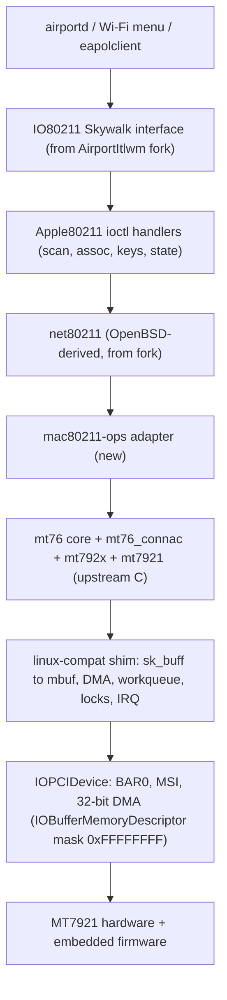
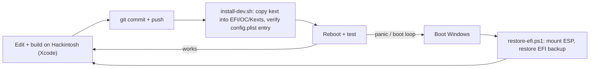

# MT7921 (RZ608) native Wi-Fi for macOS Tahoe 26.7.1: project plan

## Decisions (from the interview)

| # | Topic | Decision |
|---|---|---|
| 1 | Platform | x86_64 Hackintosh, **AMD CPU**, OpenCore. No AppleVTD, so DMA must work with the IOMapper off |
| 2 | Hardware knowledge | **Port Linux mt76** (ISC license). Ghidra/REA are for macOS internals (IO80211/Skywalk, Apple80211) and for checking firmware behavior |
| 3 | macOS integration | **Native Wi-Fi menu** (IO80211 over Skywalk), no root patches |
| 4 | Base codebase | **Fork a Tahoe-capable AirportItlwm** (e.g. laobamac/itlwm). Keep the Apple-facing glue and net80211, swap the Intel backend for mt7921. Result: one kext, installed by dropping it into the EFI |
| 5 | Scope | Full Wi-Fi including AWDL/Continuity, **split into gated milestones** |
| 6 | Bluetooth | Separate `MTKBluetoothFirmware.kext` (WMT firmware upload) + BlueToolFixup |
| 7 | Dev loop | **Develop, build and test on the Hackintosh itself** (Xcode + MacKernelSDK + 26.7.1 KDK). Windows (dual boot) is the recovery environment and can host Ghidra/REA sessions. See [Dev workflow](#dev-workflow) |
| 8 | Firmware | **Embedded and compressed** in the kext, generated from a pinned linux-firmware tag |
| 9 | Porting style | **Stay close to upstream**: mt76 C files behind a thin linux-compat shim, plus a mac80211-ops adapter driven by net80211. Proven upstream logic gives stability, and fixes stay easy to merge |
| 10 | Chips | Public GitHub repo. Whole **mt7921e family** (MT7921/RZ608 `14c3:0608`, `14c3:7961`, MT7922/RZ616 `14c3:0616`, MT7920) |

## Architecture

## Dev workflow

- **Loading:** each test build is injected through OpenCore and needs a reboot. SIP stays at your normal setting.
- **Internet without Wi-Fi:** the Hackintosh has no Wi-Fi while you develop, so use Ethernet or USB tethering (needed for git, the AI agent and docs).
- **Recovery:**
  - Keep a known-good `EFI.backup` folder on the ESP.
  - `restore-efi.ps1` (Windows: `mountvol S: /s`, then swap the EFI folders) undoes a bad build in about 1 minute.
  - Optionally keep an OpenCore USB stick as a last resort.
- **Kill switch:** the kext checks a boot-arg (`-mtkoff`) and bails out of `start()`. Set it in the OpenCore picker to boot past a panic without going through Windows.
- **Panic forensics:**
  - After a panic reboot, collect `/Library/Logs/DiagnosticReports/*.panic`.
  - Keep `keepsyms=1 debug=0x100` in boot-args.
  - Keep a ring buffer of the kext's own logs and dump it through `log show --predicate 'sender == "MTKWifi"'`.
- **Commit discipline:** always push before rebooting. A panic during a file write on APFS is rare but possible.
- **Everything runs on the Hackintosh:** workspace (e.g. `~/Projects/mtkwifi`), the AI agent, Ghidra plus its MCP server, and REA. Windows is used only for EFI recovery.
- **Ghidra on macOS:**
  - Install JDK 21 and Ghidra, then start the Ghidra MCP server and register it in the agent's MCP config on the Mac.
  - Keep the Ghidra project in its own folder outside the repo (e.g. `~/Ghidra/mtkwifi.gpr`), so it never gets committed.
  - RE targets live on that machine:
    - from the 26.7.1 KDK: `IO80211Family`, `IOSkywalkFamily`, `IONetworkingFamily`
    - the installed AirportItlwm fork build, for comparison
    - the mt7921 firmware blobs, if you need to check behavior.
- **Before each test reboot:** save the Ghidra project. A panic loses unsaved analysis, so turn on auto-save or save often.

## Milestones

| M | Goal | Exit criterion |
|---|---|---|
| **M0** Setup | Xcode + KDK on the Hackintosh, repo with the fork imported, firmware→C generator, `install-dev.sh` + Windows `restore-efi.ps1`, `-mtkoff` kill switch, logging, Ethernet/tethering, hardware IDs collected | Fork builds and loads from the EFI on 26.7.1; recovery from Windows tested once on purpose |
| **M1** Tahoe IO80211 check | Use Ghidra/REA on 26.7.1 `IO80211Family`/`IOSkywalkFamily` (from the KDK) and diff vtables/class layouts against the fork's headers. Stub backend that reports a fake scan result | Fake SSID shows up in the Wi-Fi menu |
| **M2** PCIe bring-up | Match, BAR map, MSI, WFDMA init, driver/fw-own handshake, patch + RAM firmware download, MCU message channel | Firmware version string logged, MCU commands answered |
| **M3** Shim + mt76 core | linux-compat layer, mt76 files compiling, adapter skeleton, TX/RX rings running | Interrupt-driven RX of MCU events, no leaks under load |
| **M4** Scan | `hw_scan` offload → net80211 → Apple80211 scan results | Real networks listed in the menu |
| **M5** Connect | Auth/assoc, key install through `set_key` (HW crypto), data path, open + WPA2-PSK via macOS's supplicant | DHCP + browsing, iperf soak for 1 h |
| **M6** PHY/regulatory | HT/VHT/HE rates, 5 GHz, 6 GHz with CLC/regdomain, WPA3-SAE (external auth) | Expected throughput reached, 6 GHz associates |
| **M7** Power | Sleep/wake, runtime PM / deep sleep, ASPM, firmware power save | 50 sleep/wake cycles with no reconnect failure |
| **M8** Robustness | Roaming, chip reset/recovery path (as in mt7921 `reset_work`), perf tuning, stress tests | 24 h stability run |
| **M9** Bluetooth | `MTKBluetoothFirmware.kext`: USB match, WMT firmware upload, handoff to the generic HCI stack | BT pairing + BLE works with BlueToolFixup |
| **M10** AWDL research ⚠️ | Study the AirportItlwm-Tahoe AWDL implementation, then prototype mt7921 ROC + a second vif and measure slot jitter | **Go/no-go**: AirDrop works, or we fall back to BLE-only Continuity |
| **M11** Release | Packaging, OpenCore install docs, CI, issue templates for testers | Tagged v1.0 |

## Main risks

> [!WARNING]
> - **Tahoe's private IO80211/Skywalk ABI** can change between point releases (26.7.x). M1 exists to catch this early.
> - **AMD with no IOMapper**: needs 32-bit DMA-capable bounce/contiguous buffers, and AMD PCIe/ASPM quirks.
> - **AWDL** is research-grade and gated in M10.
> - **License mix**: check the fork's license against mt76's ISC files before going public (ISC is permissive, so low risk).

## Open items for the user
1. Paste `ioreg -l | grep -i -A5 14c3` and `system_profiler SPUSBDataType` from the Hackintosh.

➜  ghidra-mcp git:(dev) system_profiler SPUSBDataType
➜  ghidra-mcp git:(dev)

➜  ghidra-mcp git:(dev) ioreg -l | grep -i -A5 14c3
    | |   |             |   "IOName" = "pci14c3,608"
    | |   |             |   "pcidebug" = "6:0:0"
    | |   |             |   "IOChildIndex" = 1
    | |   |             |   "IOPCIExpressLinkStatus" = 4114
    | |   |             |   "IOPCIExpressCapabilities" = 2
    | |   |             |   "Capability Offsets" = {"LatencyToleranceReportingCapability"=264,"PowerManagementCapability"=248,"L1PMSubstatesCapability"=272,"PCIExpressCapability"=128,"ErrorReportingCapability"=512,"MSICapability"=224,"VSEC"=256}
--
    | |   |             |   "name" = <"pci14c3,608">
    | |   |             |   "subsystem-id" = <08060000>
    | |   |             |   "acpi-pmcap-offset" = 248
    | |   |             |   "IOPCIL1PMCapabilities" = 7340831
    | |   |             |   "compatible" = <"pci14c3,608","pciclass,028000","WLAN">
    | |   |             |   "IOPCIExpressDeviceCapabilities2" = 1050655
    | |   |             |   "acpi-wake-type" = 2
    | |   |             |   "IOPCIExpressDeviceCapabilities" = 275288032
    | |   |             |   "IOReportLegendPublic" = Yes
    | |   |             |   "reg" = <0000060000000000000000000000000000000000100006420000000000000000000000000000100018000642000000000000000000000000004000002000064200000000000000000000000000100000>
--
    | |   |               |   "IOPCIPrimaryMatch" = "0x796114c3 0x060814c3 0x792214c3"
    | |   |               |   "IOMACAddress" = <f889d2dae4ff>
    | |   |               |   "IOMatchCategory" = "IODefaultMatchCategory"
    | |   |               |   "CFBundleIdentifier" = "com.laobamac.SimpleMtkWlan"
    | |   |               |   "IOMaxPacketSize" = 1518
    | |   |               |   "IOSelectedMedium" = "00000020"

2. Confirm that Xcode, the 26.7.1 KDK, JDK 21 + Ghidra (with the MCP server) are installed on the Hackintosh, and that it has wired internet or USB tethering.

KDK - idk if it is, the rest is correct

please confirm yourself agent

3. Confirm the BIOS options available (ASPM, Above-4G/ReBAR).

yes they are
